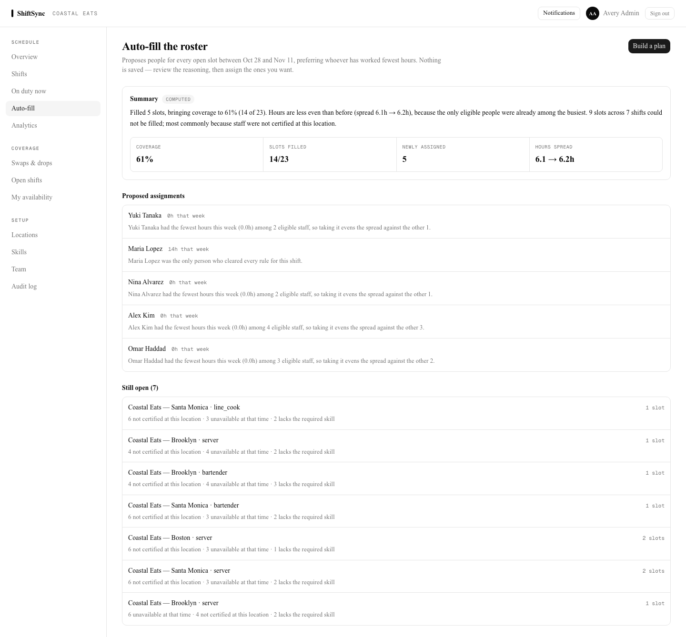

# ShiftSync API

Backend for a staff scheduling app built around a restaurant group with four locations in two timezones. Managers create shifts, assign staff, handle swaps and availability, and can ask the planner to suggest who should fill open slots. Built with NestJS, Prisma and PostgreSQL.

The web frontend lives in a separate `shiftsync-fe` repo.



## What's in it

- Shifts, assignments, availability, swaps, skills, locations and team management
- A constraint engine that checks every rule for an assignment (certification, skill, availability, double booking, minimum rest, daily hours, consecutive days) and returns all failures at once instead of just the first
- Rest and consecutive-day rules evaluated in each location's local timezone
- A roster planner (`POST /api/planner/plan`) that proposes staff for open slots using a greedy approach: hardest shifts first, then fewest hours, then fewest premium shifts. It only suggests, it doesn't write assignments
- Analytics on hours, overtime and premium shift fairness, plus an audit log
- Auth through Supabase, or a built-in local provider when no Supabase credentials are set

## Getting started

The easiest way is Docker Compose. It expects `shiftsync-fe` to be cloned next to this repo, since the web service builds from `../shiftsync-fe`.

```bash
docker compose up --build
```

- Web: http://localhost:3200
- API: http://localhost:4000/api
- Swagger: http://localhost:4000/api/docs

The database gets seeded with locations, staff and some history. All seeded accounts use the password `CoastalEats!2026` (set by `SEED_PASSWORD`), for example `admin@coastaleats.test`, `east-manager@coastaleats.test` or `sarah@coastaleats.test`.

### Without Docker

You need a Postgres database. Apply the auth schema stub once, since a few migrations expect objects that Supabase normally provides:

```bash
psql "$DATABASE_URL" -f docker/00-auth-schema.sql
npm ci
cp .env.example .env
npx prisma migrate deploy
npm run seed
npm run start:dev
```

The API listens on port 4000 by default.

## Configuration

See `.env.example`. The main variables:

- `DATABASE_URL`, `DIRECT_URL`: Postgres connection
- `AUTH_PROVIDER`: force `local` or `supabase` (otherwise picked automatically)
- `SUPABASE_URL`, `SUPABASE_SECRET_KEY`: enable Supabase auth
- `LOCAL_AUTH_SECRET`: signing key for the local provider's tokens
- `SEED_PASSWORD`: password for seeded accounts

## Tests

```bash
npm test
```

Unit tests cover the constraint engine (including timezone cases), the local identity provider and the plan explainer. They don't need a database or network.

## Notes

- The local auth provider is meant for development. It has no refresh tokens, lockout or password reset.
- The planner recomputes eligibility after each placement, which is fine for a handful of sites but would need batching for a larger chain.
- Applying a suggested plan is still done one assignment at a time.
